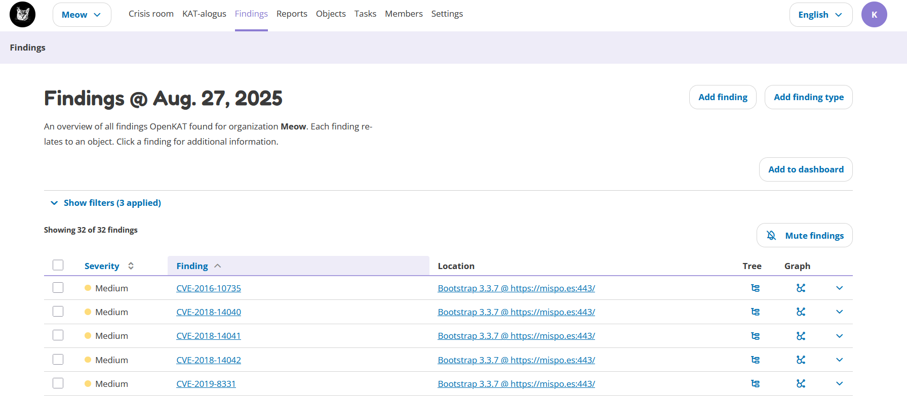
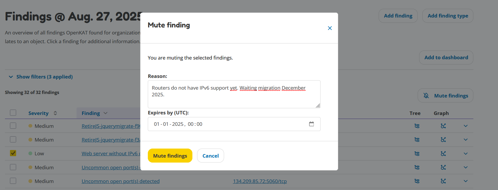

Findings
========

The Findings page gives an overview of all findings found by OpenKAT.

The filter section can be used to apply various filters to show specific findings (e.g. critical findings only) and/or hosts.
The search bar can be used to search for specific findings or hosts. Clicking on a finding shows more information on this finding.
Each finding can be viewed in the tree or graph by clicking the corresponding icons behind the finding.

A finding is also an object in the data model. This simply means that the finding can also be found on the Objects page.

Muted findings
--------------
Findings can be muted until a specific date. This will prevent the finding(s) from showing up in the default view.
Using the filters you can show all muted findings, or both muted and non-muted findings.

One or more findings can be selected. The textbox at the bottom allows for a description
as to why this finding is muted (e.g. for audit purposes, or for review at a later point in time).
Below the textbox the expiry date for the selected findings can be provided.
Click the button 'Mute Findings' to mute the selected findings.

.. _filtering-by-group-and-tag:

Filtering by group and tag
--------------------------
Every finding describes a certain kind of problem, such as a weak TLS cipher or a missing email record.
The findings page groups these kinds of problems into categories, which you can filter on with the
**Group** dropdown. Broader labels that apply across categories can be filtered with the **Tag** dropdown.

A few things to know:

- Selecting a group shows the findings assigned to that category. Findings can belong to more than
  one category: a finding about an insecure cookie is both an *HTTP Cookies* finding and a
  *Web Security* finding.
- Selecting both a group and a tag shows only findings that match both.
- The group and tag filters combine with the other filters on this page, such as severity and search.

The list of groups and tags below is maintained by the OpenKAT developers and grows with the product.

Available groups
^^^^^^^^^^^^^^^^

Authentication and Access Control
    Authentication and access control weaknesses.

Cloud and Infrastructure
    Cloud services and infrastructure configuration.

DNS Security
    DNS records, delegation and DNSSEC.

Email Security
    Email authentication and domain email security.

General Configuration
    Configuration weaknesses without a more specific technical group.

HTTP Cookies
    HTTP cookie security properties. Sub-category of Web Security.

HTTP Exposure
    Exposure of web resources and endpoints. Sub-category of Web Security.

HTTP Security Headers
    HTTP response header security controls. Sub-category of Web Security.

Information Disclosure
    Unintended disclosure of technical or sensitive information.

Internet Standards
    Compliance with internet standards and routing security.

IPv6
    IPv6 availability and connectivity.

Known Vulnerabilities
    Identified or reported security vulnerabilities.

Network Exposure
    Exposed network services and ports.

Other Findings
    Findings without a more specific security domain.

Privacy
    Privacy-related security and data protection.

Software Security
    Software inventory, updates and malware.

TLS and Certificates
    TLS protocols, ciphers and certificates.

Web Security
    Security of websites and web applications. Contains the sub-categories HTTP Cookies,
    HTTP Exposure and HTTP Security Headers.

Available tags
^^^^^^^^^^^^^^

Misconfiguration
    The finding is caused by a wrong setting, rather than by, for example, outdated software.

How the categories relate
^^^^^^^^^^^^^^^^^^^^^^^^^

*Web Security* is the only category with sub-categories: *HTTP Cookies*, *HTTP Exposure* and
*HTTP Security Headers*. A finding in a sub-category also belongs to the main category, so every
*HTTP Security Headers* finding is also a *Web Security* finding. All other categories stand on
their own. Tags are independent of the categories: the *Misconfiguration* tag can occur in any
of them.

Working with sub-categories
^^^^^^^^^^^^^^^^^^^^^^^^^^^

Filtering on *Web Security* shows the findings of its sub-categories as well, because those findings
also belong to *Web Security* itself. To narrow down, select the sub-category directly, for example
*HTTP Security Headers* to see only header findings. If you ever come across a sub-category finding
that does not appear under its main category, filter on the sub-category itself.
