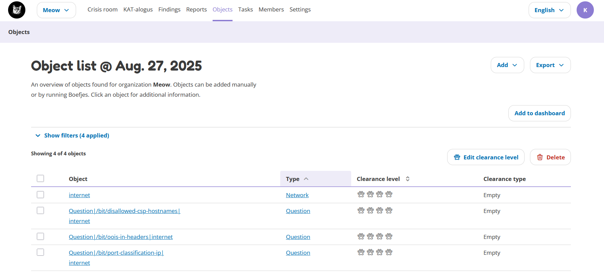
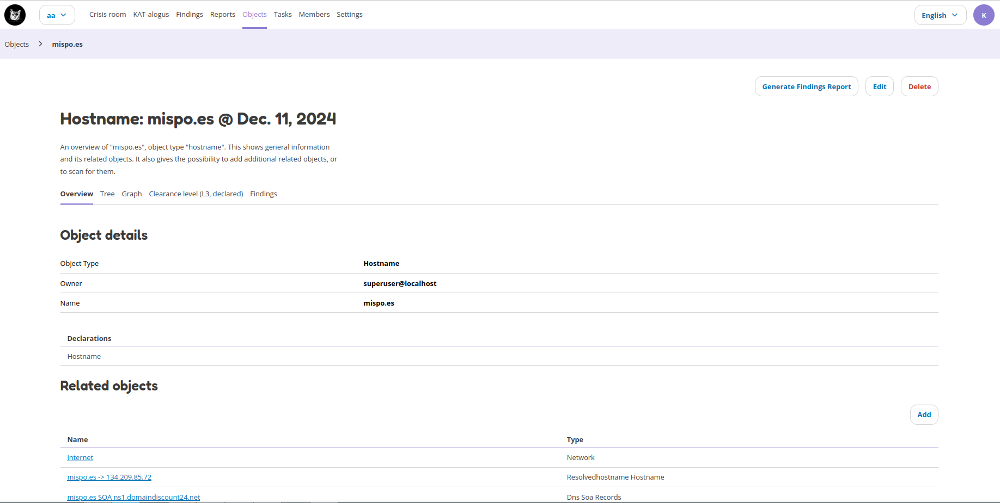

Objects
=======

Objects overview
----------------

The Objects page lists all the objects in OpenKAT (Octopoes). Objects can be anything, like DNS records, hostnames, URLs, software, software versions, ports, etc.
It is any piece of information that is found by the normalizers, bits and boefjes. On a new installation you'll see the following objects by default:

The table gives an overview on the following items:

- **Object:** this is the piece of data that was identified, such as a port, software version, hostname, etc.
- **Object type:** this shows how this object is labelled.
- **Clearance level:** this shows the clearance level of this object. See :doc:`basic-concepts/scan-levels-and-indemnification` for more information.
- **Clearance type:** this shows what kind of clearance level is set on the object. See :doc:`basic-concepts/objects-and-recursion` for more information.

The objects can be filtered by object type, clearance level and clearance type.
The search functionality can also be used to search for specific objects, such as hostnames.

More information on objects is provided by clicking on the object. This will give an overview page with all information for the specific object. The object details page is further described below.

Adding a subnet
---------------

Subnets are added through a dedicated two-step form. On the Add object page, select *IPV4NetBlock* or
*IPV6NetBlock*; both open the same form, and the address family follows from the CIDR you enter.

In the first step, enter the subnet in CIDR notation (for example ``192.168.5.0/24``), a network, and an optional name.
An address with host bits set, such as ``192.168.1.5/24``, is automatically normalized to its subnet (``192.168.1.0/24``).
The second step shows the computed range: the start IP, the end IP, and the number of addresses that will be added.
If the range is larger than a /22 (IPv4) or /118 (IPv6), a notice explains that nmap will skip it by default.

On this page you can also set the clearance level directly, up to your own maximum. Submitting adds the network,
the start IP and the netblock in one go. Adding a subnet requires that you have accepted indemnification for
your organization; without it the form is disabled. See :doc:`basic-concepts/scan-levels-and-indemnification`.

.. note:: Ranges larger than a /22 (IPv4) or /118 (IPv6) are skipped by the nmap boefjes by default. To have such
   a range scanned, add smaller blocks instead.

Pasting multiple objects
------------------------

Multiple objects can be added at once by pasting a list. This is available through the *Paste objects* option in the
Add menu on the Objects page, and through the link on the Add object page.

In the first step, paste your objects into the text field and choose a network. Each value may be an IPv4 or IPv6
address, a subnet in CIDR notation (for example ``192.0.2.0/24``), a hostname, or a URL; the type of each value is
detected automatically. Values may be separated by newlines, commas or spaces.

The second step shows every value with its detected object type for review. Lines that could not be interpreted are
listed and will not be added; all other objects are. On this page you can also set a clearance level for all objects
at once, up to your own maximum. Submitting adds the objects in one batch, and the pasted text is stored as evidence
with the objects.

Object details
--------------

Object details can be found by clicking on an object on the Objects page. Object details provide data on that specific object and how it relates to other objects. The following detail tabs are available:

- **Overview:** the overview tab gives object details, it's declaration, related objects (objects that are somehow related), tasks that ran on this object, findings that are applicable to this object and a list of boefjes that can scan this object.
- **Tree:** the tree tab shows how all objects are related to this object. The point of view will be from the specific object. Thus the view for a hostname will be slightly different than the tree view for an IP address. Filters can be applied to the tree view.
- **Graph:** the graph tab visually shows how the objects are connected using lines. The graph is interactive, meaning you can click on objects in the graph. Filters can be applied to the graph view.
- **Clearance level:** the clearance level can be changed on the clearance level tab. This tab also shows the clearance type (declared, inherited, empty) and the inheritance tree for the object.
- **Findings:** the findings tab shows all findings that are linked to this object. Different objects have different findings, meaning that the Findings tab for a hostname is likely different from the findings tab for an IP address.

